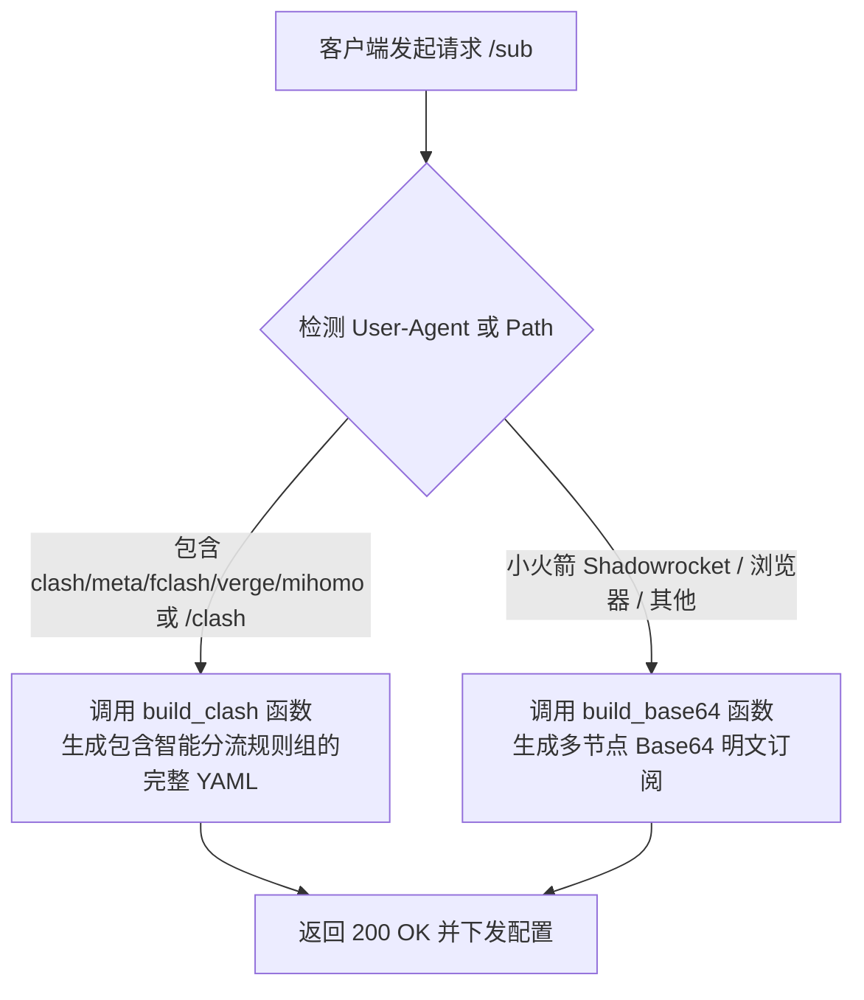

# 统一智能分流订阅服务维护与 AI Agent 协作指南

本文档专门用于指导运维人员及 AI Agent（如 Antigravity、Claude Code、Cursor、OpenCode 等）自动化维护部署在甲骨文云（Oracle Cloud）上的**统一多节点智能分流订阅聚合服务**。

---

## 一、服务器环境与服务架构

* **SSH 免密连接**：`ssh oracle`（对应用户 `ubuntu`，具备无密码 `sudo` 权限）
* **核心服务脚本**：`/usr/local/bin/unified_sub.py`
* **系统 systemd 服务**：`unified-sub.service`
* **订阅对外入口**：
  * **HTTPS 入口（推荐）**：`https://of.interviewpig.xyz:2096/sub`
  * **HTTP 入口（免证书备用）**：`http://of.interviewpig.xyz/sub`
  * **显式 Clash 格式入口**：`https://of.interviewpig.xyz:2096/clash`

---

## 二、核心工作机制（为什么不直接用 S-UI 原生订阅）

原生 S-UI / 3X-UI 面板的订阅存在四大痛点：
1. **无法跨服务器聚合**：面板只能下发本机的节点，无法跨厂商聚合（如绿云日本、搬瓦工美西）。
2. **格式单一**：无法同时让小火箭（Base64）和 FClash/Clash（YAML）共用同一个链接。
3. **无智能业务分流**：原生订阅缺少对加密货币（防风控固定 IP）、国际 AI、国内直连的精细策略组分流。
4. **单线程容易卡死**：公网扫描爬虫发起慢速连接时容易占满进程，导致手机更新提示“网络连接超时”。

本项目中的 `unified_sub.py` 采用 **`ThreadingHTTPServer` 多线程高并发架构 + 15 秒 Socket 熔断保护**，并内置 **User-Agent 自动嗅探引擎**：



---

## 三、策略组与分流矩阵定义

在 `build_clash()` 中，内置了以下标准策略组与路由规则：

| 分组图标与名称 | 节点分流策略 | 适用业务场景与特征规则 |
| :--- | :--- | :--- |
| **🚀 节点选择** | `select` 手动主控 | 全局总控开关，可手动选定具体单节点或切到自动优选 |
| **♻️ 自动优选** | `url-test` 延迟测速 | 每 300 秒向 Google 发起 204 探针，自动切换最低延迟节点 |
| **🤖 国际AI** | `select` 优选美西/新加坡 | `openai`, `chatgpt`, `anthropic`, `claude`, `perplexity`, `copilot` 等 |
| **🪙 加密货币** | `select` 锁定日本绿云 | `binance`, `okx`, `bybit`, `coinbase`, `tradingview`, `metamask`（低延迟防风控） |
| **📺 国际媒体** | `select` 自动调度 | `youtube`, `netflix`, `spotify`, `googlevideo.com` 等流媒体 |
| **🎯 国内直连** | `select` 强制 DIRECT | `baidu`, `taobao`, `alipay`, `weibo`, `bilibili`, `qq`, `cn` 域名及 `GEOIP,CN` |
| **🐟 漏网之鱼** | `select` 兜底代理 | 未命中上述规则的所有其他海外流量，默认走代理防失联 |

---

## 四、AI Agent 自动化修改标准操作流程（SOP）

当需要让 AI 增加分流域名、调整策略组或增删节点时，**请让 AI 严格按照以下 4 步执行**：

### 步骤 1：连接与自动备份
```bash
ssh oracle "sudo cp /usr/local/bin/unified_sub.py /usr/local/bin/unified_sub.py.bak_$(date +%Y%m%d_%H%M%S)"
```

### 步骤 2：编辑规则或节点
* **添加分流规则**：在 `unified_sub.py` 中定位到 `build_clash()` 内部的 `rules = [...]` 列表。
  * 规则语法：
    * `DOMAIN-KEYWORD,关键词,策略组名称`
    * `DOMAIN-SUFFIX,域名后缀,策略组名称`
  * ⚠️ **重要排序要求**：新增加的规则**必须放在 `"GEOIP,CN,🎯 国内直连"` 与 `"MATCH,🐟 漏网之鱼"` 之前**，否则会被兜底规则提前截胡！
* **增减节点**：在文件头部的 `RAW_NODES = [...]` 字典列表中维护，需同时提供 `uri` 与 `clash` 配置。

### 步骤 3：语法编译检查与服务重启
```bash
ssh oracle "sudo python3 -m py_compile /usr/local/bin/unified_sub.py && sudo systemctl restart unified-sub"
```

### 步骤 4：连通性与服务健康检查
```bash
# 检查 systemd 服务状态
ssh oracle "sudo systemctl status unified-sub --no-pager | head -n 12"

# 验证双端下发是否正常
curl -s -k -I -A "Shadowrocket/2.2.0" https://of.interviewpig.xyz:2096/sub | head -n 2
curl -s -k -I -A "FClash/1.0" https://of.interviewpig.xyz:2096/sub | head -n 2
```

---

## 五、客户端同步与更新

* **iOS 小火箭（Shadowrocket）**：在首页配置列表中找到该订阅，长按或下拉点击 **“更新订阅”** 即可同步最新节点。
* **安卓 / PC（FClash / Clash Verge / FLClash）**：进入“配置 / Profiles”，点击右侧刷新按钮，最新的分流规则与节点组即可瞬间生效。
